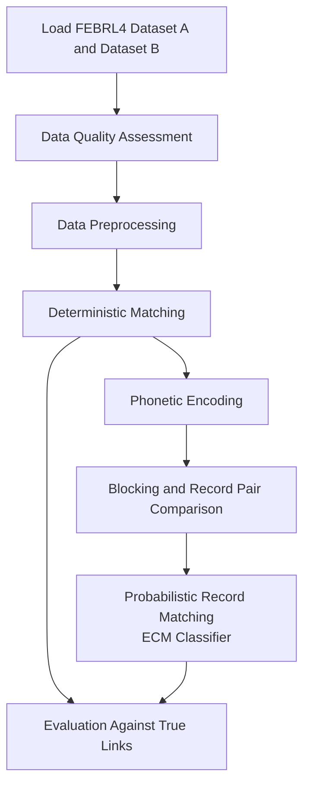

# Record-Linkage-with-Python
This project implements a hybrid record linkage pipeline using the FEBRL4 dataset. The goal is to identify records referring to the same real-world entity across two datasets, even when some attributes are missing, inconsistent, or represented differently.

The solution combines deterministic matching and probabilistic record linkage. It uses data quality assessment, data cleaning, phonetic encoding, blocking, and record pair comparison to improve matching efficiency while maintaining high matching accuracy.

The project is implemented in Python 3.12.7 using Pandas and the Python Record Linkage Toolkit.

Objectives of this work:
+ Assess data quality and identify inconsistencies in the source datasets.
+ Reduce the number of record pairs using blocking techniques.
+ Identify high-confidence matches using deterministic rules and detect additional potential matches through probabilistic record linkage.

## Source
The project uses the FEBRL4 dataset, loaded through the recordlinkage Python package.
The dataset consists of two datasets:
+ Dataset A: 5,000 records
+ Dataset B: 5,000 records

The initial search space contains 25 million possible record pairs (5,000 × 5,000).

The dataset provides a set of true matching pairs (true_links), which is used as ground truth for evaluating the matching results. It is not used to train or tune the matching model.

## Record Linkage Workflow

### Data Quality Assessment
The analysis focuses on missing values and duplicate entries across variables. It also examines invalid dates of birth, postcode formatting and length, street number data types, and the uniqueness of Social Security IDs.

### Data Cleaning and Standardization
The cleaning stage prepares the datasets for matching.

Operations include:
+ Converting string attributes to lowercase.
+ Converting dates of birth to datetime format.
+ Handling invalid dates by converting them to NaT.
+ Converting street numbers to integer types.
+ Standardizing postcodes to four-character strings.

No records are removed during this cleaning stage.

### Deterministic Matching
High-confidence matches are identified using three exact matching rules:
+ Social Security ID + Surname
+ Given Name + Surname + Date of Birth
+ Surname + Date of Birth + Postcode

The resulting pairs are combined and duplicate pairs are removed.
Records matched at this stage are excluded from the subsequent probabilistic matching stage.

### Phonetic Encoding
Phonetic features are generated for first name and surname using Soundex method to support matching when names differ in spelling.
These features are subsequently used in the blocking and record comparison stages.

### Blocking
Blocking reduces the number of record pairs that need to be compared.

The following blocking rules are evaluated:
Social Security ID, Date of Birth, Postcode, Phonetic Surname + Date of Birth 

Candidate pairs generated by the individual rules are combined, and duplicate pairs are removed.
The blocking performance is evaluated using Reduction Ratio and Pairs Completeness.

### Record Pair Comparison
Candidate pairs are compared using a combination of exact and string similarity features.
The comparison features include all initial variables, phonetic first name and phonetic surname.
Jaro-Winkler similarity is used for selected string attributes, while exact comparison is applied to the remaining features.

### Probabilistic Matching
The comparison feature matrix is processed using the ECMClassifier from the Python Record Linkage Toolkit. 

The output includes final set of probabilistic matches based on match probability for each candidate pair. Seven records from each dataset remained unmatched and were selected for manual review.

### Results
The final hybrid matching results are evaluated against the ground-truth matching pairs.
The evaluation metrics for hybrid model include Precision, Recall and F-score.

The hybrid approach successfully identified 4,993 matching pairs out of 5,000 ground-truth links, achieving an F-score of 99.93%.

The deterministic matching stage identified 3,330 pairs, while the probabilistic matching stage recovered an additional 1,663 true links.

The blocking technique significantly reduced the number of candidate pairs while retaining 99.58% of the true links. The reduction ratio of 99.74% demonstrates the efficiency of the indexing strategy in limiting unnecessary comparisons.

Seven records from each dataset remained unmatched and were selected for manual review.

Deterministic Matching:
Matched pairs: 3,330 from 5,000 rows
Remaining records in A: 1,670
Remaining records in B: 1,670

Probabilistic Matching:
Total possible remaining pairs: 2,788,900
Candidate pairs after Blocking: 7,388
ECM predicted matches: 1,663
True links captured by Blocking: 1663

Blocking Pairs Completeness: 99.58%
Blocking Reduction Ratio: 99.74%

Final Hybrid Matching Evaluation:
Final matches: 4993
Precision: 100.00%
Recall: 99.86%
F-score: 99.93%

## Methods Comparison and Experimental Analysis
1. Hybrid vs. probabilistic approach. 
The hybrid approach is preferable to using probabilistic matching alone, as it reduces memory and computational requirements. By applying deterministic matching followed by blocking, the number of candidate record pairs was reduced to 7,388, compared to 54,639 pairs in the probabilistic-only approach with blocking. This difference is expected to become even more significant when working with larger datasets.

2. Method Selection
Supervised learning methods were not considered, as real-world record linkage projects typically lack labelled matching pairs (ground truth) required for model training and objective evaluation. Therefore, an unsupervised probabilistic approach was selected.
The ECMClassifier, based on the Fellegi–Sunter statistical model, was used to classify candidate record pairs based on their attribute similarity.

3. Reliability of individual attributes.
The Social Security ID was identified as the most reliable attribute based on the Data Quality Assessment, with no missing values or duplicates. However, even the strongest individual attribute should not be used as a standalone matching rule in deterministic record linkage. In this dataset, one record was incorrectly identified as a match and prematurely excluded from further analysis. Therefore, deterministic matching rules should combine at least two reliable attributes to reduce the risk of false matches.

4. Impact of removing the Social Security ID.
When the Social Security ID is removed from the dataset, the number of records requiring manual review after automated matching using the hybrid approach increases from 7 to 64.

5. Scalability and technology selection.
For a dataset containing 5,000 records, pandas provides sufficient data processing capabilities. For larger datasets, PySpark may be a more suitable alternative due to its distributed processing capabilities.

## How to Run
1. Clone the repository:

git clone https://github.com/troldata/Record-Linkage-with-Python.git

cd Record-Linkage-with-Python

2. Install the required packages: pip install pandas recordlinkage

3. Run the pipeline: main_file.py

## Future Improvements
The current version focuses on implementing and evaluating the complete hybrid matching pipeline.

Planned improvements include:
+ Automated testing: unit tests and integration tests using pytest.
+ Error analysis: investigation of false positives and false negatives, including the reasons for missed true matches.
+ Method comparison.
